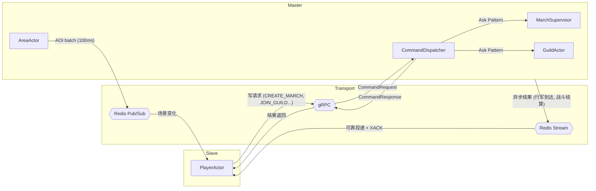
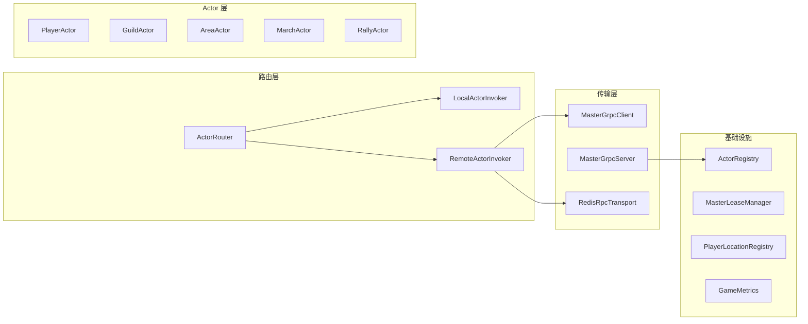
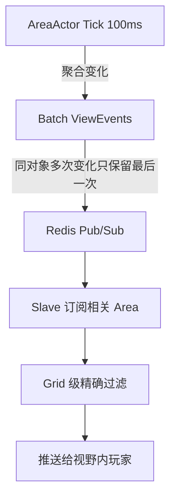
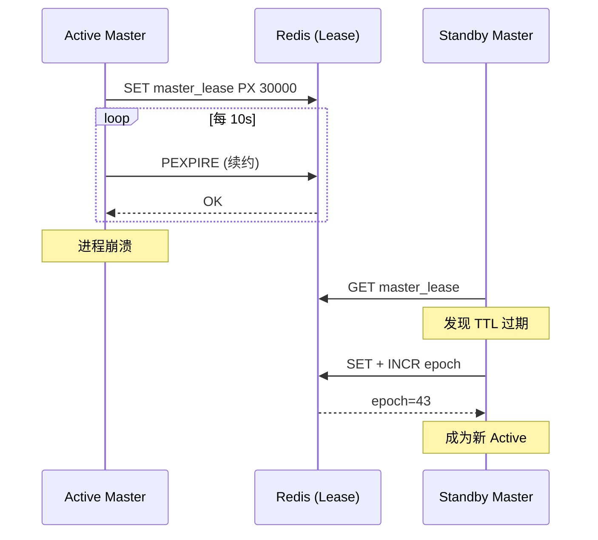
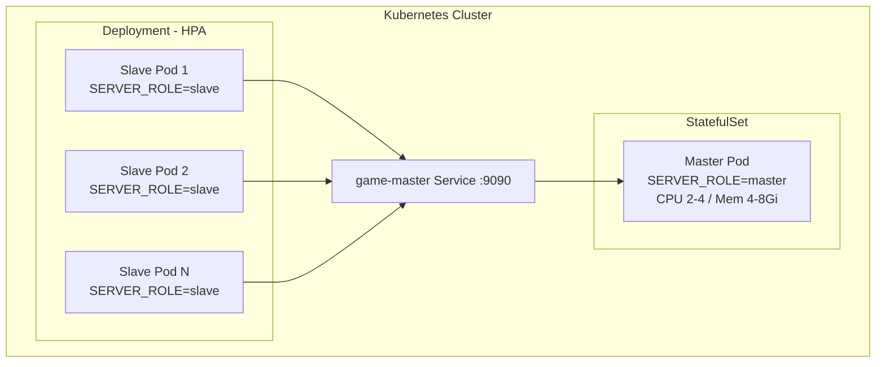

# Nexus Actor Framework

[](https://openjdk.org/)
[](https://spring.io/projects/spring-boot)
[](https://pekko.apache.org/)
[](https://grpc.io/)
[]()

基于 Apache Pekko Typed 的游戏服务器 Actor 框架，专为 4X-SLG 类型游戏设计。支持 Master/Slave 分离部署、gRPC 强交互写请求、Redis Stream 异步事件、AOI 视野推送，单服承载 2w 在线玩家。

---

## 架构总览

```mermaid
graph TB
    subgraph Clients
        C1[Client 1]
        C2[Client 2]
        C3[Client N]
    end

    subgraph Slave Pod A
        SA_PA[PlayerActor 1..N]
        SA_AOI[AOI Filter]
    end

    subgraph Slave Pod B
        SB_PA[PlayerActor 1..N]
        SB_AOI[AOI Filter]
    end

    subgraph Master Pod
        direction TB
        MS[MapSceneActor]
        AA[AreaActor 1~196]
        MARCH[MarchSupervisor]
        RALLY[RallySupervisor]
        EVENT[EventSupervisor]
        GUILD[GuildActor]
        MA[MarchActor *]
        RA[RallyActor *]
        WB[WorldBossActor]
        GW[GuildWarActor]

        MS --> AA
        MS --> MARCH
        MS --> RALLY
        MS --> EVENT
        MARCH --> MA
        RALLY --> RA
        EVENT --> WB
        EVENT --> GW
    end

    subgraph Storage
        Redis[(Redis)]
        DDB[(DynamoDB)]
    end

    C1 --> SA_PA
    C2 --> SA_PA
    C3 --> SB_PA

    SA_PA -->|gRPC Write| Master Pod
    SB_PA -->|gRPC Write| Master Pod

    Master Pod -->|Pub/Sub AOI| Redis
    Redis -->|AOI Events| SA_AOI
    Redis -->|AOI Events| SB_AOI
    SA_AOI --> SA_PA
    SB_AOI --> SB_PA

    Master Pod -->|Stream Async| Redis
    Redis -->|Reliable Events| SA_PA
    Redis -->|Reliable Events| SB_PA

    Master Pod --> DDB
    Master Pod --> Redis
```

---

## 通信架构



---

## 技术栈

| 组件 | 版本 | 用途 |
|------|------|------|
| Java | 25 | Virtual Threads + Sealed Interface + Record |
| Spring Boot | 4.0.0 | DI + Auto Configuration + Actuator |
| Apache Pekko Typed | 1.1.3 | Actor 模型核心 |
| gRPC | 1.68.0 | Slave → Master 强交互写请求 |
| Redis (Lettuce) | Spring Boot 管理 | Pub/Sub AOI + Stream RPC + 缓存 + Lease |
| AWS DynamoDB | SDK 2.31.1 | 玩家/公会持久化 |
| Micrometer + Prometheus | Spring Boot 管理 | 可观测性指标 |

---

## 核心模块



---

## 核心特性

### AOI 视野系统

地图 1000x1000 格子，划分为 196 个区域（14x14 布局，每区域 75x75）。



- 视口订阅：玩家 openMap 时按视口范围订阅 Area
- 移动 diff：moveView 只处理增量变化（新增/移除的 Area 和 Grid）
- 背压控制：ViewThrottler 限制 pending 事件数量

### 行军系统（无 Tick）

MarchActor 不使用定时 tick，出发时计算完整路径和到达时间，设置单次定时器。支持召回、拦截、加速等中断操作。路径经过的 Area 会收到 MarchLineEnter/Leave 通知。

### 集结系统（状态机）

```
WAITING → MARCHING → BATTLING → RETURNING → DISMISSED
```

RallyActor 使用 Pekko Typed Behavior 切换实现多阶段状态机，每个阶段只处理该阶段合法的消息。

### Master Lease 高可用



---

## 持久化策略

| Actor | 存储 | 策略 |
|-------|------|------|
| PlayerActor | DynamoDB | 已有逻辑 |
| GuildActor | DynamoDB + Redis | 写同步 DDB，Redis 供读 |
| AreaActor | Redis | 1s 异步批量，失败 reMarkDirty |
| MarchActor | Redis | MarchStateStore 持久化活跃行军 |
| RallyActor / WorldBoss | Redis | 定期快照 |

---

## 扩展点

框架通过 Behavior 接口留出业务扩展点：

| 接口 | 职责 |
|------|------|
| `AreaBehavior` | 区域 tick、攻击处理、初始对象生成 |
| `MarchBehavior` | 到达时间计算、战斗结果、路线信息 |
| `RallyBehavior` | 加入条件、出发/到达逻辑 |
| `GuildBehavior` | 加入/踢出条件、捐献、人数上限 |
| `PlayerMessageHandler` | 请求处理、视野更新构建 |
| `PlayerSession` | 网络层抽象 |

---

## 部署模型



| 角色 | 副本数 | 环境变量 | 资源 | 部署策略 |
|------|--------|----------|------|----------|
| Master | 1 | `SERVER_ROLE=master` `SERVER_ID=1` | CPU 2-4, Mem 4-8Gi | StatefulSet / Recreate |
| Slave | 2-5 | `SERVER_ROLE=slave` `SERVER_ID=1` | CPU 1-2, Mem 2-4Gi | Deployment / HPA by CPU 70% |

---

## 快速开始

```java
// 创建框架实例
var rpcTransport = new RedisRpcTransport(redisTemplate, serializer,
        serverId, podId, 4096, 30);
var framework = ActorFramework.create(rpcTransport, metrics);

// Master: 启动 gRPC Server
if (framework.getRoleProvider().isMaster()) {
    framework.startGrpcServer();

    var sceneRef = framework.getSystem().systemActorOf(
        MapSceneActor.create(registry, router, cacheProvider,
            streamPublisher, serializer, serverId,
            areaBehavior, marchBehavior, rallyBehavior),
        "map-scene");
    sceneRef.tell(new SceneMessage.Init(196));
}

// 玩家连接时创建 PlayerActor
var playerRef = framework.getSystem().systemActorOf(
    PlayerActor.create(playerId, session, isMaster,
        router, streamConsumer, serverId, handler, aoiCalc, 200, 100),
    "player-" + playerId);
framework.getRegistry().register(ActorType.PLAYER, playerId, playerRef);
```

---

## 构建

```bash
mvn compile    # 编译（含 protobuf 代码生成）
mvn package    # 打包
mvn install    # 安装到本地仓库
```

## 配置

核心配置项在 `application.yml` 中，支持环境变量覆盖：

```yaml
game:
  server-id: ${SERVER_ID:1}
  pod-id: ${POD_ID:local}
  server-role: ${SERVER_ROLE:master}
  grpc:
    deadline-ms: 2000
  dispatch:
    max-concurrent: 1024
  lease:
    ttl-seconds: 30
    heartbeat-interval-ms: 10000
```

---

## 可观测性

内置 Micrometer + Prometheus 指标：

| 指标 | 说明 |
|------|------|
| gRPC 调用延迟 | CommandDispatcher 计时 |
| 并发 dispatch 数 | 实时在途请求数 |
| dispatch 错误率 | 失败/超时计数 |
| Lease 续约延迟 | Master 心跳计时 |
| Lease epoch | 当前主备代次 |

访问 `/actuator/prometheus` 获取指标数据。

---

## 项目结构

```
src/main/java/io/nexus/
├── ActorFramework.java          # 框架入口
├── address/                     # ActorAddress + ActorType
├── base/                        # StashableActor, TickableActor
├── dynamodb/                    # DynamoDB 持久化
├── grpc/                        # gRPC Client/Server/Dispatcher
├── guild/                       # 公会 Actor
├── lifecycle/                   # GracefulShutdown, FlushableActor
├── metrics/                     # GameMetrics, HealthIndicators
├── persistence/                 # 持久化抽象接口
├── player/                      # 玩家 Actor
├── redis/                       # Redis 通信层
├── registry/                    # Actor 注册表
├── role/                        # ServerRoleProvider, MasterLeaseManager
├── router/                      # ActorRouter 路由层
├── rpc/                         # RPC 消息处理
├── scene/                       # 场景系统
│   ├── aoi/                     # AOI 视野计算
│   ├── area/                    # 区域 Actor
│   ├── event/                   # 世界事件 (WorldBoss, GuildWar)
│   ├── march/                   # 行军系统
│   └── rally/                   # 集结系统
├── serialize/                   # 序列化
└── view/                        # 视野事件
```
