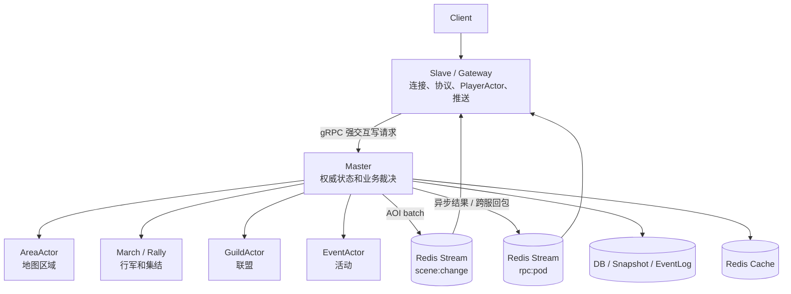

# 4X-SLG 单服 Master/Slave 架构优化方案

> 本方案面向单服最多约 2w 在线玩家的 4X-SLG 服务器。

---

## 目标和约束

<table>
<tr><th width="80">分类</th><th>内容</th></tr>
<tr>
<td><strong>核心目标</strong></td>
<td>
• 保留单个权威 Master，避免过早引入多 Master / 多 Owner / 跨分片事务<br>
• Slave 只负责连接、协议解析、玩家会话、客户端推送和 AOI 过滤<br>
• Master 只负责权威写入，包括地图、行军、集结、联盟、活动和战斗裁决<br>
• Master 与 Slave 共享同一个 <code>serverId</code>，用 <code>podId</code> 区分具体进程<br>
• 强交互写请求优先使用 gRPC，异步事件和 AOI 使用 Redis Stream
</td>
</tr>
<tr>
<td><strong>当前不做</strong></td>
<td>
• 多 SceneOwner<br>
• 多 GuildOwner 分片<br>
• 热备实时状态同步<br>
• 跨分片战斗事务<br>
• 所有 RPC 都塞进 Redis Stream
</td>
</tr>
</table>

---

## 核心概念

三个 ID/角色必须分清：

<table>
<tr><th width="120">字段</th><th width="280">含义</th><th>示例</th></tr>
<tr><td><code>serverId</code></td><td>逻辑服 / 世界 / kingdom</td><td><code>1</code></td></tr>
<tr><td><code>podId</code></td><td>当前 Pod 实例</td><td><code>game-slave-7d8f9c</code></td></tr>
<tr><td><code>role</code></td><td>当前进程职责</td><td><code>master</code> / <code>slave</code></td></tr>
</table>

环境变量示例：

```text
1服 Master:                1服 Slave A:              1服 Slave B:
  SERVER_ID=1                SERVER_ID=1               SERVER_ID=1
  SERVER_ROLE=master         SERVER_ROLE=slave         SERVER_ROLE=slave
  POD_ID=game-master-0       POD_ID=game-slave-a       POD_ID=game-slave-b
```

`serverId` 相同是合理的，因为 Master 和 Slave 服务的是同一个游戏世界。真正决定点对点回包位置的是 `podId`。

---

## 推荐架构



### 职责划分

<table>
<tr><th width="140">进程</th><th>负责</th><th>不负责</th></tr>
<tr>
<td><strong>Master</strong></td>
<td>地图权威写入、战斗裁决、行军/集结、联盟、活动、状态落地</td>
<td>玩家连接、大量读缓存、玩家级 AOI 过滤</td>
</tr>
<tr>
<td><strong>Slave</strong></td>
<td>网络连接、协议解析、PlayerActor、客户端推送、AOI 过滤、读缓存</td>
<td>地图/联盟/活动权威状态修改</td>
</tr>
<tr>
<td><strong>Redis Stream</strong></td>
<td>AOI、异步通知、跨服回包、削峰</td>
<td>Master 内部高频 Actor 调用</td>
</tr>
<tr>
<td><strong>DB</strong></td>
<td>快照、事件日志、恢复数据</td>
<td>高频临时状态同步</td>
</tr>
</table>

---

## ActorAddress 设计

当前只靠 `serverId` 不够，PlayerActor 需要定位到具体 Slave。

```java
public record ActorAddress(
    ActorType type,
    long id,
    int serverId,
    String podId
) {}
```

地址示例：

```java
ActorAddress.player(10001, 1, "game-slave-a");
ActorAddress.area(120, 1);
ActorAddress.marchSupervisor(1);
ActorAddress.guild(8888, 1);
```

规则：

<table>
<tr><th width="320">Actor 类型</th><th>podId 要求</th></tr>
<tr><td><code>PLAYER</code></td><td>必须带 <code>podId</code></td></tr>
<tr><td><code>AREA</code> / <code>GUILD</code> / <code>MARCH_SUPERVISOR</code> / <code>RALLY_SUPERVISOR</code> / <code>EVENT</code></td><td>默认属于该 <code>serverId</code> 的 Master</td></tr>
</table>

### 路由规则

```java
if (target.type() == ActorType.PLAYER) {
    if (target.serverId() == currentServerId
            && target.podId().equals(currentPodId)) {
        local.tell(target, message);
    } else {
        remote.tellToPod(target.serverId(), target.podId(), envelope);
    }
} else {
    if (target.serverId() == currentServerId
            && roleProvider.isMaster()) {
        local.tell(target, message);
    } else {
        remote.tellToMaster(target.serverId(), envelope);
    }
}
```

回包逻辑统一：无论 1服 Master → 1服 Slave 还是 2服 Master → 1服 Slave，都看 `replyTo.serverId` + `replyTo.podId`，发到目标玩家所在 Pod。

---

## K8s 配置方式

Master 和 Slave 使用同一镜像，不同环境变量。

<details>
<summary><strong>Master StatefulSet</strong></summary>

```yaml
apiVersion: apps/v1
kind: StatefulSet
metadata:
  name: game-master
spec:
  serviceName: game-master
  replicas: 1
  selector:
    matchLabels:
      app: game-server
      role: master
  template:
    metadata:
      labels:
        app: game-server
        role: master
        server-id: "1"
    spec:
      containers:
        - name: game-server
          image: your-game-server:latest
          env:
            - name: SERVER_ID
              value: "1"
            - name: SERVER_ROLE
              value: "master"
            - name: POD_ID
              valueFrom:
                fieldRef:
                  fieldPath: metadata.name
```

</details>

<details>
<summary><strong>Slave Deployment</strong></summary>

```yaml
apiVersion: apps/v1
kind: Deployment
metadata:
  name: game-slave
spec:
  replicas: 3
  selector:
    matchLabels:
      app: game-server
      role: slave
  template:
    metadata:
      labels:
        app: game-server
        role: slave
        server-id: "1"
    spec:
      containers:
        - name: game-server
          image: your-game-server:latest
          env:
            - name: SERVER_ID
              value: "1"
            - name: SERVER_ROLE
              value: "slave"
            - name: POD_ID
              valueFrom:
                fieldRef:
                  fieldPath: metadata.name
```

</details>

<details>
<summary><strong>Master gRPC Service</strong></summary>

```yaml
apiVersion: v1
kind: Service
metadata:
  name: game-master
spec:
  selector:
    app: game-server
    role: master
    server-id: "1"
  ports:
    - name: grpc
      port: 9090
      targetPort: 9090
```

Slave 调用地址：`game-master.default.svc.cluster.local:9090`

</details>

---

## 通信方式选择

<table>
<tr><th width="240">场景</th><th width="140">推荐方式</th><th>原因</th></tr>
<tr><td>Slave → Master 强交互写请求</td><td>gRPC</td><td>请求-响应天然匹配，延迟低，接口强类型</td></tr>
<tr><td>Master → Slave 即时结果</td><td>gRPC response</td><td>请求内直接返回，不需要二次消息</td></tr>
<tr><td>Master → Slave 异步结果</td><td>Redis Stream</td><td>结果可能稍后产生，例如行军到达</td></tr>
<tr><td>AOI 场景变化</td><td>Redis Stream</td><td>适合 batch、广播、削峰</td></tr>
<tr><td>Master 内部 Actor 通信</td><td>本地 ActorRef</td><td>不要绕 Redis 或 gRPC</td></tr>
<tr><td>战报、日志、异步事件</td><td>Redis Stream / MQ</td><td>可削峰，可异步落地</td></tr>
</table>

### gRPC 适合什么

适合马上要结果的玩家写请求：创建行军、加入联盟、创建集结、迁城、建造、购买道具、领取奖励。

```text
Client → Slave PlayerActor → Master gRPC Execute(CommandRequest) → Master Actor 处理 → gRPC CommandResponse → Slave 回客户端
```

### Redis Stream 适合什么

适合异步和广播：AOI 推送、行军到达通知、战斗异步结算结果、跨服回包、世界事件广播、日志/战报异步处理。

Stream key 约定：

<table>
<tr><th width="200">用途</th><th>Key 格式</th></tr>
<tr><td>发给目标服 Master</td><td><code>rpc:master:{serverId}</code></td></tr>
<tr><td>发给目标 Pod</td><td><code>rpc:pod:{serverId}:{podId}</code></td></tr>
<tr><td>AOI</td><td><code>scene:change:{serverId}:{areaId}:{chunkId}</code></td></tr>
</table>

同服和跨服回包保持一致：

```text
1服 Master → 1服 Slave-A:  rpc:pod:1:game-slave-a
2服 Master → 1服 Slave-A:  rpc:pod:1:game-slave-a
```

---

## gRPC 命令入口设计

第一版使用统一命令入口，避免每个业务都暴露一个 RPC 方法。

```proto
syntax = "proto3";
package game.rpc;

service MasterCommandService {
  rpc Execute(CommandRequest) returns (CommandResponse);
}

message ActorAddress {
  string type      = 1;
  int64  id        = 2;
  int32  server_id = 3;
  string pod_id    = 4;
}

message CommandRequest {
  string       request_id     = 1;
  int64        player_id      = 2;
  int32        server_id      = 3;
  string       source_pod_id  = 4;
  string       command_type   = 5;
  bytes        payload        = 6;
  ActorAddress reply_to       = 7;
  int64        deadline_ms    = 8;
}

message CommandResponse {
  string request_id    = 1;
  bool   success       = 2;
  string error_code    = 3;
  string error_message = 4;
  bytes  payload       = 5;
}
```

Slave 侧调用：

```java
CommandResponse resp = masterStub
    .withDeadlineAfter(2, TimeUnit.SECONDS)
    .execute(req);
```

Master 侧分发（gRPC Service 不直接修改业务状态，转成 Actor 消息）：

```java
public CompletableFuture<CommandResponse> dispatch(CommandRequest req) {
    return switch (req.getCommandType()) {
        case "CREATE_MARCH" -> createMarch(req);
        case "JOIN_GUILD"   -> joinGuild(req);
        case "ATTACK"       -> attack(req);
        default             -> failed(req, "UNKNOWN_COMMAND");
    };
}
```

---

## 超时和幂等

gRPC 能告诉调用方"这次调用超时了"，但不能告诉调用方"服务端业务到底有没有成功"。

**典型问题：**

```text
Slave 调 CreateMarch(requestId=abc)
→ Master 已扣兵并创建 marchId=9001
→ 网络抖动导致 Slave 收到 DEADLINE_EXCEEDED
→ Slave 重试 requestId=abc
→ 如果没有幂等：重复扣兵、创建两条行军、重复发奖励
```

### 幂等处理

所有写请求必须带 `requestId` + `playerId` + `commandType` + `serverId`。

```java
CommandResponse handle(CommandRequest req) {
    String key = "idem:" + req.getServerId()
            + ":" + req.getPlayerId()
            + ":" + req.getRequestId();

    CommandResponse old = idemStore.get(key);
    if (old != null) return old;

    CommandResponse resp = executeBusiness(req);
    idemStore.put(key, resp, Duration.ofMinutes(10));
    return resp;
}
```

<table>
<tr><th width="120">类型</th><th>请求列表</th></tr>
<tr><td><strong>必须幂等</strong></td><td>创建行军、撤军、加速、迁城、攻击、加入联盟、捐献、购买道具、领取奖励、创建集结、加入集结</td></tr>
<tr><td><strong>可弱幂等</strong></td><td>查询地图、查询联盟信息、查询排行榜、拉取战报列表</td></tr>
</table>

---

## 玩家位置表

Master 有时只有 `playerId`，不知道玩家在哪个 Slave。需要维护玩家位置表。

```text
Redis key:  player_location:{serverId}:{playerId} = podId
示例:       player_location:1:10001 = game-slave-a
```

<table>
<tr><th width="100">时机</th><th>操作</th></tr>
<tr><td>登录</td><td><code>SETEX player_location:1:10001 60 game-slave-a</code>（定期续约）</td></tr>
<tr><td>断线</td><td><code>DEL player_location:1:10001</code></td></tr>
<tr><td>Pod 异常退出</td><td>TTL 到期后自然清理</td></tr>
</table>

---

## AOI 推送策略

AOI 不要做玩家级 RPC，推荐 batch 模式：

```text
AreaActor 每 100ms 聚合变化
→ 同一对象多次变化只保留最后一次
→ 按 area/chunk 发布 batch
→ Slave 订阅相关 chunk
→ Slave 对本机玩家做精确 Grid 过滤
→ 推给客户端
```

示例：

```text
Master AreaActor-120 → XADD scene:change:1:120:3 events=[...]
game-slave-a 订阅 scene:change:1:120:3 → 判断视野覆盖 → 推给客户端
```

Master 不需要知道每个玩家当前连在哪个 Slave，也不需要逐个玩家推送。

---

## Redis Stream 使用底线

<table>
<tr><th width="40">#</th><th>要求</th></tr>
<tr><td>1</td><td>使用 consumer group + <code>XACK</code>，不要只靠内存 <code>lastId</code></td></tr>
<tr><td>2</td><td>消息带 <code>requestId</code> / <code>eventId</code>，业务侧支持幂等</td></tr>
<tr><td>3</td><td>定期 <code>XTRIM</code>，避免 Stream 无限增长</td></tr>
<tr><td>4</td><td>pending 消息要有重试或清理机制</td></tr>
<tr><td>5</td><td>AOI 必须 batch，不要一对象一消息、一玩家一消息</td></tr>
<tr><td>6</td><td>Master 内部 Actor 调用不要走 Redis</td></tr>
</table>

---

## 单 Master 主备方案

2w 在线目标下，优先做冷备，不做热备。

```text
Active Master:                          Standby Master:
  处理写请求                               不处理写请求
  启动 gRPC Service                        尝试抢 lease
  消费必要 Stream                           抢主成功后恢复状态并开始服务
  持续续约 lease
```

Master lease 记录：

```text
pk           = MASTER_LOCK#1
ownerPodId   = game-master-0
epoch        = 42
leaseUntil   = 1710000000000
heartbeatAt  = 1709999995000
```

关键点：

<table>
<tr><th width="40">#</th><th>规则</th></tr>
<tr><td>1</td><td>Active 定期续约</td></tr>
<tr><td>2</td><td>Standby 发现 lease 过期后抢主</td></tr>
<tr><td>3</td><td>每次换主 <code>epoch</code> 递增</td></tr>
<tr><td>4</td><td>关键写入带 <code>epoch</code>，旧主复活后不能继续写</td></tr>
<tr><td>5</td><td>gRPC Service 只路由到 Active，或 Standby 返回 <code>NOT_ACTIVE</code> 让 Slave 重试</td></tr>
</table>

---

## 当前代码优先修复项

<table>
<tr><th width="60">优先级</th><th width="160">主题</th><th>具体内容</th><th width="60">状态</th></tr>
<tr>
<td rowspan="7"><strong>P0</strong><br/>架构闭环</td>
<td colspan="3"></td>
</tr>
<tr><td><code>ActorAddress</code></td><td>增加 <code>podId</code> 字段，<code>player()</code> 工厂方法必须传入 podId</td><td>✅ 完成</td></tr>
<tr><td><code>ServerRoleProvider</code></td><td>增加 <code>podId</code>，从 <code>POD_ID</code> 环境变量读取</td><td>✅ 完成</td></tr>
<tr><td><code>ActorRouter</code></td><td>PLAYER 路由改为比较 <code>podId</code>，不再无条件 local</td><td>✅ 完成</td></tr>
<tr><td>RpcTransport</td><td>新增 <code>sendTellToPod</code>，RemoteActorInvoker 按 target 类型选择路由；新增 <code>RedisPodConsumer</code> 统一消费 Pod 级 tell + response</td><td>✅ 完成</td></tr>
<tr><td>Area 编号</td><td>统一 0-based，<code>1000x1000 / 75x75</code> = <code>196</code> 个 Area</td><td>✅ 完成</td></tr>
<tr><td>Master/Slave 启动范围</td><td>Master 只启动场景/联盟/活动 Actor；Slave 只启动网络层、PlayerActor、AOI</td><td>待验证</td></tr>
<tr>
<td rowspan="5"><strong>P1</strong><br/>gRPC 写请求</td>
<td colspan="3"></td>
</tr>
<tr><td>Master gRPC Service</td><td>增加统一命令入口</td><td>待开始</td></tr>
<tr><td>Slave 写请求</td><td>通过 gRPC 调 Master</td><td>待开始</td></tr>
<tr><td>异步结果</td><td>行军到达、战斗结果继续走 Redis Stream 回玩家所在 Pod</td><td>待开始</td></tr>
<tr><td>幂等</td><td>所有写请求加入 <code>requestId</code></td><td>待开始</td></tr>
<tr>
<td rowspan="5"><strong>P2</strong><br/>AOI 可靠化</td>
<td colspan="3"></td>
</tr>
<tr><td>AOI</td><td>改为 batch + chunk stream</td><td>待开始</td></tr>
<tr><td>序列化</td><td>统一 <code>List&lt;ViewEvent&gt;</code> 与单个 <code>ViewEvent</code> 的协议</td><td>待开始</td></tr>
<tr><td>Redis Stream</td><td>使用 consumer group、ack、trim</td><td>待开始</td></tr>
<tr><td>玩家位置表</td><td>加入 TTL 续约</td><td>待开始</td></tr>
<tr>
<td rowspan="5"><strong>P3</strong><br/>状态安全</td>
<td colspan="3"></td>
</tr>
<tr><td>Actor 状态加载</td><td>异步加载完成后通过 <code>self.tell(LoadedState)</code> 修改状态，不能在 Future 回调线程直接改</td><td>待开始</td></tr>
<tr><td>持久化</td><td>失败不能清 dirty</td><td>待开始</td></tr>
<tr><td>长生命周期状态</td><td>行军、集结、活动必须可恢复</td><td>待开始</td></tr>
<tr><td>冷备</td><td>增加 Master lease、epoch、状态恢复流程</td><td>待开始</td></tr>
</table>

---

## 最终建议

对单服最多 2w 在线的目标，推荐落地方案：

<table>
<tr><th width="40">#</th><th>组件</th></tr>
<tr><td>1</td><td>单 Active Master</td></tr>
<tr><td>2</td><td>多 Slave / Gateway</td></tr>
<tr><td>3</td><td>冷备 Master</td></tr>
<tr><td>4</td><td>Slave → Master gRPC</td></tr>
<tr><td>5</td><td>Master → Slave 异步 Redis Stream</td></tr>
<tr><td>6</td><td>AOI batch Redis Stream</td></tr>
<tr><td>7</td><td>requestId 幂等</td></tr>
<tr><td>8</td><td>Actor 状态安全加载</td></tr>
<tr><td>9</td><td>异步可靠持久化</td></tr>
</table>

不要当前阶段引入多 Master 分片。先把单 Master 做成只负责权威裁决的稳定核心，再通过 Gateway/Slave 扩连接和推送能力。等压测证明单 Master 的写入瓶颈确实到达，再考虑按地图或联盟拆 Owner。
