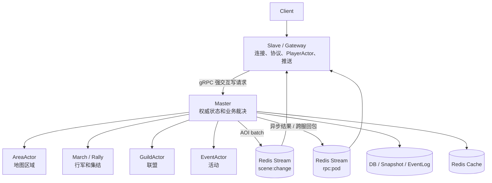

# 4X-SLG 单服 Master/Slave 架构优化方案

## 目标和约束

本方案面向单服最多约 2w 在线玩家的 4X-SLG 服务器。

核心目标：

- 保留单个权威 Master，避免过早引入多 Master / 多 Owner / 跨分片事务。
- Slave 只负责连接、协议解析、玩家会话、客户端推送和 AOI 过滤。
- Master 只负责权威写入，包括地图、行军、集结、联盟、活动和战斗裁决。
- Master 与 Slave 共享同一个 `serverId`，用 `podId` 区分具体进程。
- 强交互写请求优先使用 gRPC，异步事件和 AOI 使用 Redis Stream。

不建议当前阶段做：

- 多 SceneOwner。
- 多 GuildOwner 分片。
- 热备实时状态同步。
- 跨分片战斗事务。
- 所有 RPC 都塞进 Redis Stream。

## 核心概念

三个 ID/角色必须分清：

| 字段 | 含义 | 示例 |
|---|---|---|
| `serverId` | 逻辑服 / 世界 / kingdom | `1` |
| `podId` | 当前 Pod 实例 | `game-slave-7d8f9c` |
| `role` | 当前进程职责 | `master` / `slave` |

示例：

```text
1服 Master:
  SERVER_ID=1
  SERVER_ROLE=master
  POD_ID=game-master-0

1服 Slave A:
  SERVER_ID=1
  SERVER_ROLE=slave
  POD_ID=game-slave-a

1服 Slave B:
  SERVER_ID=1
  SERVER_ROLE=slave
  POD_ID=game-slave-b
```

`serverId` 相同是合理的，因为 Master 和 Slave 服务的是同一个游戏世界。真正决定点对点回包位置的是 `podId`。

## 推荐架构



职责划分：

| 进程 | 负责 | 不负责 |
|---|---|---|
| Master | 地图权威写入、战斗裁决、行军/集结、联盟、活动、状态落地 | 玩家连接、大量读缓存、玩家级 AOI 过滤 |
| Slave | 网络连接、协议解析、PlayerActor、客户端推送、AOI 过滤、读缓存 | 地图/联盟/活动权威状态修改 |
| Redis Stream | AOI、异步通知、跨服回包、削峰 | Master 内部高频 Actor 调用 |
| DB | 快照、事件日志、恢复数据 | 高频临时状态同步 |

## ActorAddress 设计

当前只靠 `serverId` 不够，PlayerActor 需要定位到具体 Slave。

推荐：

```java
public record ActorAddress(
    ActorType type,
    long id,
    int serverId,
    String podId
) {}
```

地址示例：

```java
ActorAddress.player(10001, 1, "game-slave-a");
ActorAddress.area(120, 1);
ActorAddress.marchSupervisor(1);
ActorAddress.guild(8888, 1);
```

含义：

- `PLAYER` 必须带 `podId`。
- `AREA`、`GUILD`、`MARCH_SUPERVISOR`、`RALLY_SUPERVISOR`、`EVENT` 默认属于该 `serverId` 的 Master。

路由规则：

```java
if (target.type() == ActorType.PLAYER) {
    if (target.serverId() == currentServerId
            && target.podId().equals(currentPodId)) {
        local.tell(target, message);
    } else {
        remote.tellToPod(target.serverId(), target.podId(), envelope);
    }
} else {
    if (target.serverId() == currentServerId
            && roleProvider.isMaster()) {
        local.tell(target, message);
    } else {
        remote.tellToMaster(target.serverId(), envelope);
    }
}
```

这样可以保证：

```text
1服 Master -> 1服 Slave
2服 Master -> 1服 Slave
```

都使用同一种回包逻辑：

```text
看 replyTo.serverId + replyTo.podId
发到目标玩家所在 Pod
```

## K8s 配置方式

Master 和 Slave 可以使用同一镜像，不同环境变量。

Master:

```yaml
apiVersion: apps/v1
kind: StatefulSet
metadata:
  name: game-master
spec:
  serviceName: game-master
  replicas: 1
  selector:
    matchLabels:
      app: game-server
      role: master
  template:
    metadata:
      labels:
        app: game-server
        role: master
        server-id: "1"
    spec:
      containers:
        - name: game-server
          image: your-game-server:latest
          env:
            - name: SERVER_ID
              value: "1"
            - name: SERVER_ROLE
              value: "master"
            - name: POD_ID
              valueFrom:
                fieldRef:
                  fieldPath: metadata.name
```

Slave:

```yaml
apiVersion: apps/v1
kind: Deployment
metadata:
  name: game-slave
spec:
  replicas: 3
  selector:
    matchLabels:
      app: game-server
      role: slave
  template:
    metadata:
      labels:
        app: game-server
        role: slave
        server-id: "1"
    spec:
      containers:
        - name: game-server
          image: your-game-server:latest
          env:
            - name: SERVER_ID
              value: "1"
            - name: SERVER_ROLE
              value: "slave"
            - name: POD_ID
              valueFrom:
                fieldRef:
                  fieldPath: metadata.name
```

Master gRPC Service:

```yaml
apiVersion: v1
kind: Service
metadata:
  name: game-master
spec:
  selector:
    app: game-server
    role: master
    server-id: "1"
  ports:
    - name: grpc
      port: 9090
      targetPort: 9090
```

Slave 调用：

```text
game-master.default.svc.cluster.local:9090
```

## 通信方式选择

推荐混合通信：

| 场景 | 推荐方式 | 原因 |
|---|---|---|
| Slave -> Master 强交互写请求 | gRPC | 请求-响应天然匹配，延迟低，接口强类型 |
| Master -> Slave 即时结果 | gRPC response | 请求内直接返回，不需要二次消息 |
| Master -> Slave 异步结果 | Redis Stream | 结果可能稍后产生，例如行军到达 |
| AOI 场景变化 | Redis Stream | 适合 batch、广播、削峰 |
| Master 内部 Actor 通信 | 本地 ActorRef | 不要绕 Redis 或 gRPC |
| 战报、日志、异步事件 | Redis Stream / MQ | 可削峰，可异步落地 |

### gRPC 适合什么

适合马上要结果的玩家写请求：

```text
创建行军
加入联盟
创建集结
迁城
建造
购买道具
领取奖励
```

典型流程：

```text
Client
  -> Slave PlayerActor
  -> Master gRPC Execute(CommandRequest)
  -> Master Actor 处理
  -> gRPC CommandResponse
  -> Slave 回客户端
```

### Redis Stream 适合什么

适合异步和广播：

```text
AOI 推送
行军到达通知
战斗异步结算结果
跨服 Master 回包到玩家所在 Slave
世界事件广播
日志/战报异步处理
```

Stream key 约定：

```text
发给目标服 Master:
rpc:master:{serverId}

发给目标 Pod:
rpc:pod:{serverId}:{podId}

AOI:
scene:change:{serverId}:{areaId}:{chunkId}
```

同服和跨服回包保持一致：

```text
1服 Master -> 1服 Slave-A:
rpc:pod:1:game-slave-a

2服 Master -> 1服 Slave-A:
rpc:pod:1:game-slave-a
```

## gRPC 命令入口设计

建议第一版使用统一命令入口，避免每个业务都暴露一个 RPC 方法。

```proto
syntax = "proto3";

package game.rpc;

service MasterCommandService {
  rpc Execute(CommandRequest) returns (CommandResponse);
}

message ActorAddress {
  string type = 1;
  int64 id = 2;
  int32 server_id = 3;
  string pod_id = 4;
}

message CommandRequest {
  string request_id = 1;
  int64 player_id = 2;
  int32 server_id = 3;
  string source_pod_id = 4;

  string command_type = 5;
  bytes payload = 6;

  ActorAddress reply_to = 7;
  int64 deadline_ms = 8;
}

message CommandResponse {
  string request_id = 1;
  bool success = 2;
  string error_code = 3;
  string error_message = 4;
  bytes payload = 5;
}
```

Slave 侧调用时设置 deadline：

```java
CommandResponse resp = masterStub
    .withDeadlineAfter(2, TimeUnit.SECONDS)
    .execute(req);
```

Master 侧 gRPC Service 不直接修改业务状态，而是把请求转成 Actor 消息：

```java
public CompletableFuture<CommandResponse> dispatch(CommandRequest req) {
    return switch (req.getCommandType()) {
        case "CREATE_MARCH" -> createMarch(req);
        case "JOIN_GUILD" -> joinGuild(req);
        case "ATTACK" -> attack(req);
        default -> failed(req, "UNKNOWN_COMMAND");
    };
}
```

## 超时和幂等

gRPC 可以解决调用层面的 deadline / timeout，但不能自动解决业务幂等。

必须明确：

```text
gRPC 能告诉调用方：这次调用超时了。
gRPC 不能告诉调用方：服务端业务到底有没有成功。
```

例如：

```text
Slave 调 CreateMarch(requestId=abc)
Master 已经扣兵并创建 marchId=9001
但网络抖动导致 Slave 收到 DEADLINE_EXCEEDED
Slave 重试 requestId=abc
```

如果 Master 没有幂等，会出现：

```text
重复扣兵
创建两条行军
重复发奖励
```

所有写请求必须带 `requestId`：

```text
requestId
playerId
commandType
serverId
```

幂等处理：

```java
CommandResponse handle(CommandRequest req) {
    String key = "idem:" + req.getServerId()
            + ":" + req.getPlayerId()
            + ":" + req.getRequestId();

    CommandResponse old = idemStore.get(key);
    if (old != null) {
        return old;
    }

    CommandResponse resp = executeBusiness(req);
    idemStore.put(key, resp, Duration.ofMinutes(10));
    return resp;
}
```

必须幂等的请求：

```text
创建行军
撤军
加速
迁城
攻击
加入联盟
捐献
购买道具
领取奖励
创建集结
加入集结
```

读请求可以弱一些：

```text
查询地图
查询联盟信息
查询排行榜
拉取战报列表
```

## 玩家位置表

Master 有时只有 `playerId`，不知道玩家在哪个 Slave。需要维护玩家位置表。

Redis key：

```text
player_location:{serverId}:{playerId} = podId
```

示例：

```text
player_location:1:10001 = game-slave-a
```

登录时 Slave 写入并定期续约：

```text
SETEX player_location:1:10001 60 game-slave-a
```

断线时删除：

```text
DEL player_location:1:10001
```

如果 Pod 异常退出，TTL 到期后自然清理，避免 Master 长期把消息发到不存在的 Slave。

## AOI 推送策略

AOI 不要做玩家级 RPC。

推荐：

```text
AreaActor 每 100ms 聚合变化
同一个对象多次变化只保留最后一次
按 area/chunk 发布 batch
Slave 订阅相关 chunk
Slave 对本机玩家做精确 Grid 过滤
```

示例：

```text
Master AreaActor-120
  -> XADD scene:change:1:120:3 events=[...]

game-slave-a 订阅 scene:change:1:120:3
  -> 判断哪些 PlayerActor 当前视野覆盖相关 Grid
  -> 推给客户端
```

这样 Master 不需要知道每个玩家当前连在哪个 Slave，也不需要逐个玩家推送。

## Redis Stream 使用底线

如果使用 Redis Stream，至少要做到：

- 使用 consumer group + `XACK`，不要只靠内存 `lastId`。
- 消息带 `requestId` / `eventId`，业务侧支持幂等。
- 定期 `XTRIM`，避免 Stream 无限增长。
- pending 消息要有重试或清理机制。
- AOI 必须 batch，不要一对象一消息、一玩家一消息。
- Master 内部 Actor 调用不要走 Redis。

## 单 Master 主备方案

2w 在线目标下，优先做冷备，不做热备。

结构：

```text
Active Master:
  处理写请求
  启动 gRPC Service
  消费必要 Stream
  持续续约 lease

Standby Master:
  不处理写请求
  尝试抢 lease
  抢主成功后恢复状态并开始服务
```

需要一条 Master lease 记录：

```text
pk = MASTER_LOCK#1
ownerPodId = game-master-0
epoch = 42
leaseUntil = 1710000000000
heartbeatAt = 1709999995000
```

关键点：

- Active 定期续约。
- Standby 发现 lease 过期后抢主。
- 每次换主 `epoch` 递增。
- 关键写入带 `epoch`，旧主复活后不能继续写。
- gRPC Service 可以只路由到 Active，或者 Standby 收到请求返回 `NOT_ACTIVE` 让 Slave 重试。

## 当前代码优先修复项

结合当前项目，建议按以下顺序改：

### P0：先让架构闭环

- `ActorAddress` 增加 `podId`。
- `ServerRoleProvider` 增加 `podId`。
- `ActorRouter` 修正 Player 路由逻辑，不能再 `case PLAYER -> true`。
- Master 只启动场景/联盟/活动 Actor。
- Slave 只启动网络层、PlayerActor、AOI 订阅和推送。
- 统一 Area 编号和数量：`1000x1000 / 75x75` 是 `196` 个 Area，不是 `169`。
- Area 编号统一为 0-based 或 1-based，不能混用。

### P1：强交互写请求走 gRPC

- 增加 Master gRPC Service。
- Slave 写请求通过 gRPC 调 Master。
- gRPC response 只返回即时结果。
- 行军到达、战斗异步结果继续走 Redis Stream 回玩家所在 Pod。
- 所有写请求加入 `requestId` 幂等。

### P2：AOI 和异步消息可靠化

- AOI 改为 batch + chunk stream。
- 统一 `List<ViewEvent>` 与单个 `ViewEvent` 的序列化协议。
- Redis Stream 使用 consumer group、ack、trim。
- 玩家位置表加入 TTL 续约。

### P3：状态安全和恢复

- Actor 异步加载完成后通过 `self.tell(LoadedState)` 修改状态，不能在 Future 回调线程直接改 Actor 内部状态。
- 持久化失败不能清 dirty。
- 长生命周期状态必须可恢复，包括行军、集结、活动。
- 增加冷备 Master lease、epoch、状态恢复流程。

## 最终建议

对单服最多 2w 在线的目标，推荐落地方案是：

```text
单 Active Master
+ 多 Slave / Gateway
+ 冷备 Master
+ Slave -> Master gRPC
+ Master -> Slave 异步 Redis Stream
+ AOI batch Redis Stream
+ requestId 幂等
+ Actor 状态安全加载
+ 异步可靠持久化
```

不要当前阶段引入多 Master 分片。先把单 Master 做成只负责权威裁决的稳定核心，再通过 Gateway/Slave 扩连接和推送能力。等压测证明单 Master 的写入瓶颈确实到达，再考虑按地图或联盟拆 Owner。
